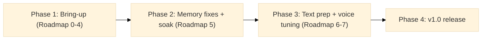

# P010 — Announcer: MVP Specification

| Field | Value |
| :--- | :--- |
| **Document Number** | KBW-P010-SPC-001 |
| **Revision** | R01 |
| **Last Updated** | 13 November 2026 |

---

## 1. Problem

| Question | Answer |
| :--- | :--- |
| **Problem** | No simple offline way to make an ESP32-S3 speak arbitrary text |
| **User** | Kezin, for bench projects and alerts |
| **Smallest version** | Type a sentence on the serial console, hear it clearly through a small amp |

---

## 2. Core MVP Features (5)

| # | Feature | Acceptance Criteria |
| :---: | :--- | :--- |
| F1 | Clean PDM audio path (GPIO 18, RC filter, PAM8403) | Speaker test chime and sweep clean, no hiss or crackle |
| F2 | Speak typed text via UART console (SAM backend) | Any typed English sentence is spoken at correct pitch and speed |
| F3 | Text preparation | `Room 12`, `10:30 AM`, `10:05`, `2026`, `0045` spoken correctly; replacement table works |
| F4 | 5 voice presets + volume control | `/v` cycles voices, `/+` `/-` change level without clipping |
| F5 | Stable unattended operation | 50 sentences with no reboot; `/i` free heap returns to same value; long unpunctuated sentence does not crash |

---

## 3. Non-Goals (v1)

- [ ] Scheduled announcements, RTC, Wi-Fi
- [ ] I2S amplifier output (amp on hand, planned for v2; v1 stays on PDM)
- [ ] Custom formant engine
- [ ] Enclosure or PCB
- [ ] Natural-sounding speech (intelligible is enough)

---

## 4. Known Issues

| ID | Issue | Location | Status |
| :--- | :--- | :--- | :---: |
| BUG-01 | PSRAM not enabled in `sdkconfig.defaults`; SAM buffer comes from internal RAM | `ver_1/sdkconfig.defaults` | `[DONE]` 2026-11-13 |
| BUG-02 | Write guard assumes 176 KB buffer even when 88 KB fallback allocated: heap overflow on chunks > ~4 s | `ver_1/main/sam/render.c:74`, `sam.c:96` | `[DONE]` 2026-11-13 |
| BUG-03 | Sample count `bufferpos / 50` not clamped to buffer size: playback over-read | `ver_1/main/tts_sam.c` | `[DONE]` 2026-11-13 |
| CFG-01 | Kconfig sample rate (16000) and boot volume unused; code hardcodes 22050 Hz / 70% | `Kconfig.projbuild`, `tts.h`, `audio_out.c` | `[PENDING]` |

---

## 5. Build Phases

| Phase | Exit Criteria |
| :--- | :--- |
| 1 | Boot chime + "Text to speech system online" heard on bench |
| 2 | BUG-01..03 closed; F5 criteria pass |
| 3 | Word list fully understandable; default voice chosen |
| 4 | `.bin` archived in `releases/` with checksum |

---

## 6. Open Questions

| Question | Needed For |
| :--- | :--- |
| ~~Module variant~~ Answered: N16R8 (16 MB flash, 8 MB octal PSRAM) | BUG-01 |
| Current bench output: 10 uF cap + speaker direct on GPIO 18 (no amp) | F1: add series resistor, see `README.md` |
