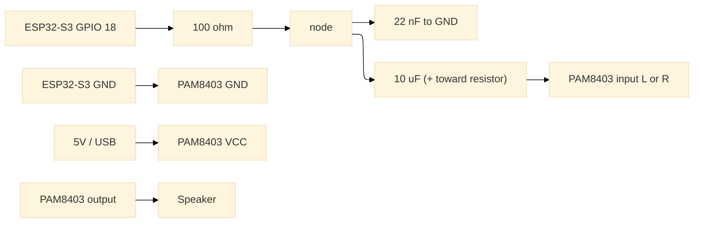

# P010 — Announcer: Quick Start

| Field | Value |
| :--- | :--- |
| **Document Number** | KBW-P010-RDM-001 |
| **Revision** | R01 |
| **Last Updated** | 13 November 2026 |

---

## 1. Wiring



| Pin | Connection | Notes |
| :--- | :--- | :--- |
| GPIO 18 | 100 ohm, 22 nF to GND, 10 uF to amp input | 1-bit PDM audio |
| GND | Amp GND, 22 nF | Common ground required |
| 5V | Amp VCC | Never power amp from a GPIO |
| USB (UART port) | PC | Console input is UART0 only |

| Current bench setup | Status |
| :--- | :--- |
| GPIO 18 -> 10 uF -> 8 ohm speaker -> GND | `[ACTIVE]` works, quiet, overloads the pin |
| GPIO 18 -> 100-220 ohm -> 10 uF -> speaker -> GND | `[RECOMMENDED]` minimum safe direct setup |
| GPIO 18 -> RC filter -> PAM8403 -> speaker | Design target |

- [ ] `[CRITICAL]` Without a series resistor an 8 ohm speaker demands far more current than a GPIO can supply; add 100-220 ohm or use an amplifier
- [ ] Add a 10 kohm pot at the amp input if loud at low software volume

---

## 1A. ver_2 Wiring: MAX98357A I2S Amplifier

| MAX98357A Pin | ESP32-S3 | Notes |
| :--- | :--- | :--- |
| VIN | 5V | 5V gives the most volume; 3.3V works but quieter |
| GND | GND | Common ground |
| DIN | GPIO 4 | I2S data |
| BCLK | GPIO 5 | Bit clock |
| LRC | GPIO 6 | Word select |
| SD | Leave unconnected | Board default: (L+R)/2 mono mix |
| GAIN | Leave unconnected | 9 dB; tie to GND for 12 dB, 100k to GND for 15 dB |
| Speaker + / - | Speaker | `[CRITICAL]` Bridged output: never connect either speaker wire to GND |

- [ ] No RC filter or capacitor needed in ver_2
- [ ] GPIO 19/20 avoided: they are the native USB D-/D+ pins
- [ ] Firmware sends the mono sample on both I2S slots so the (L+R)/2 mix is full level

---

## 2. Console Commands

| Input | Action |
| :--- | :--- |
| Any text + Enter | Speak it |
| `/1` .. `/5` | Chime + preset announcement |
| `/v` | Next voice (Classic SAM, Natural Male, Natural Female, Campus PA, Robot) |
| `/c` | Chime (C5, E5, G5) |
| `/+` `/-` | Volume +/- 10% |
| `/i` | Internal / PSRAM free memory |
| `/?` | Menu |

---

## 3. Build and Flash

```powershell
cd ver_1
.\mirror_build.ps1 -Port COM6            # build + flash from Downloads\Announcer_v1
.\mirror_build.ps1 -Port COM6 -Monitor   # same, then open monitor
```

- [ ] Do not build directly inside Google Drive: path length breaks the ESP-IDF build

| Setting | Value |
| :--- | :--- |
| ESP-IDF | v6.0.2 |
| Target | esp32s3 |
| Sample rate | 22050 Hz (hardcoded, `tts.h`) |
| Default voice | Campus PA |
| Default volume | 70% |
| Board | ESP32-S3 N16R8 (octal PSRAM enabled) |
| Monitor exit | `Ctrl + ]` |

---

## 4. Troubleshooting

| Symptom | Check |
| :--- | :--- |
| Typed text ignored | Using native USB port instead of UART port |
| Silence | Amp power, 10 uF polarity, volume, `/c` |
| Chipmunk / slow voice | Sample rate mismatch (must be 22050) |
| Random reboot on long sentences | Known BUG-01..03, see `PROJECT_SPEC.md` |
| Hiss | Missing 22 nF, poor ground, amp gain too high |

---

## 5. Third-Party Code and Voice Data

| Component | Source | Licence | In repo |
| :--- | :--- | :--- | :--- |
| `ver_*/main/sam/` | C port of SAM (Software Automatic Mouth, 1982) | No clear licence; reverse-engineered | Yes, unmodified apart from buffer-bounds fixes |
| Piper TTS | github.com/rhasspy/piper | MIT | No (download separately) |
| `en_US-lessac-medium` voice | huggingface.co/rhasspy/piper-voices | Blizzard 2013 lessac dataset licence | No |
| `ver_3/main/clips/*.pcm` | Generated from the voice above | Follows voice licence | No (regenerate) |

```powershell
# Regenerate ver_3 clips before building
python ver_3	ools\make_clips.py --piper <path>\piper.exe --model <path>\en_US-lessac-medium.onnx
```

