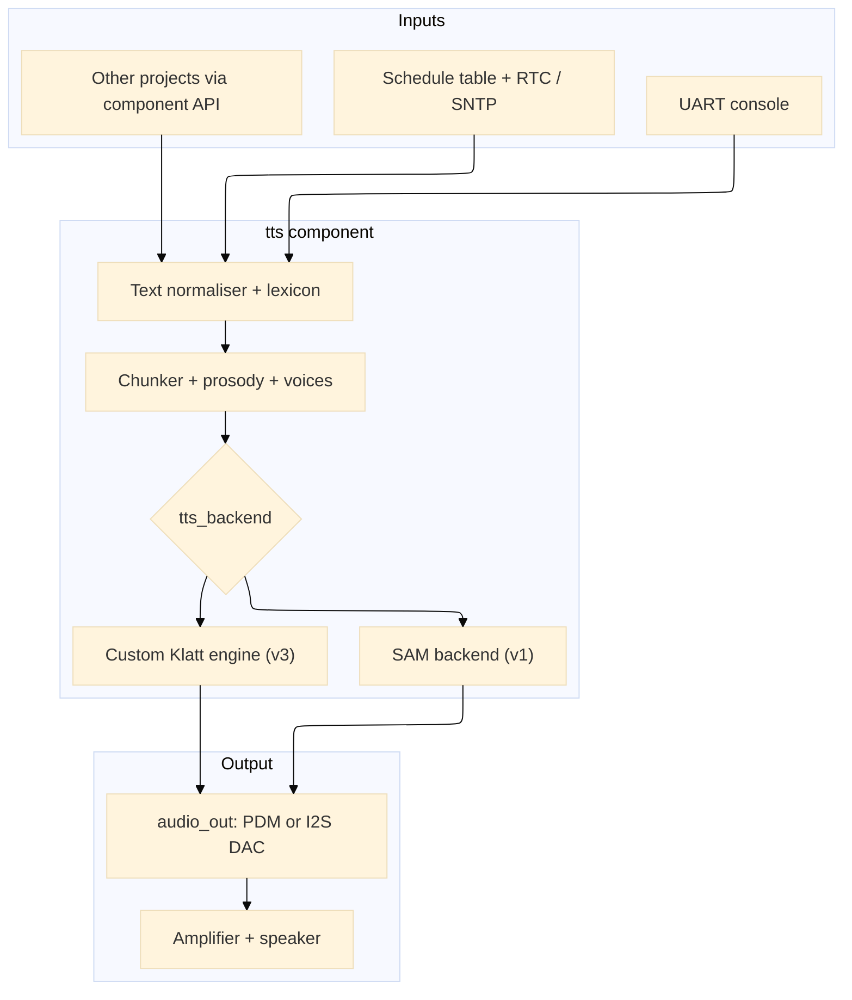

# P010 — Announcer: Product Vision

| Field | Value |
| :--- | :--- |
| **Document Number** | KBW-P010-PRJ-001 |
| **Revision** | R01 |
| **Last Updated** | 13 November 2026 |

---

## 1. Vision

| Item | Description |
| :--- | :--- |
| **What** | Fully offline text-to-speech module on a single ESP32-S3, no DAC, no cloud |
| **Why** | Spoken alerts and announcements for maker projects without internet or recorded clips |
| **End state** | Reusable `tts_*` ESP-IDF component, own formant engine, scheduled announcer appliance |
| **Quality bar** | Intelligible first time to someone who has not seen the text; naturalness is secondary |

---

## 2. End-State Architecture

---

## 3. Roadmap

| Version | Scope | Status |
| :--- | :--- | :---: |
| v1.0 | SAM speaks typed text on bench, PDM output (`ver_1/`) | `[DONE]` |
| v1.x | Tuned voices, extended pronunciation lexicon, regression word list | `[PARKED]` |
| v2.0 | MAX98357A I2S amplifier output in `ver_2/` (GPIO 4/5/6), no RC filter | `[DONE]` |
| v2.1 | Natural Piper voice clips in `ver_3/`, SAM fallback | `[DONE]` |
| v2.2 | Final voice choice + word-level clip vocabulary (numbers, times) | `[PARKED]` |
| v2.x | Scheduled announcer appliance: `announce.c`, DS3231 RTC or SNTP, schedule table, manual override | `[PARKED]` |
| v2.y | Reusable non-blocking ESP-IDF component for ESP32-S3 projects | `[PARKED]` |
| v3.0 | Custom Klatt formant engine as drop-in backend (`ver_1/docs/AURAVOICE_ENGINE.md`) | `[PARKED]` |
| v3.x | Enclosure, PCB | `[PARKED]` |

---

## 4. Long-Term Risks

| Risk | Impact | Mitigation |
| :--- | :--- | :--- |
| SAM licence unclear (reverse-engineered 1982 software) | Cannot publish or sell with SAM | Backend abstraction; v3 own engine |
| Rule-based pronunciation ~70-85% on open English | Mispronounced words | Bounded vocabulary + replacement lexicon |
| Whole-utterance buffer (up to 176 KB) | RAM pressure, crashes without PSRAM | PSRAM, clamped buffer; streaming in v3 |
| 1-bit PDM noise floor | Hiss on cheap amps | RC filter in v1; I2S amp (already bought) in v2, driver path already in `audio_out.c` |
