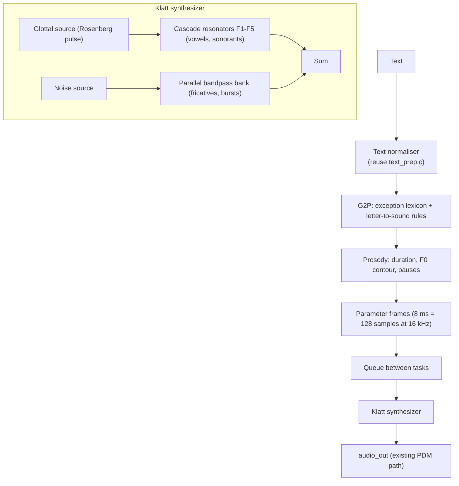

# Future Option (Parked): AuraVoice-S3, a Custom Formant TTS Engine

> **Status: parked.** The current project uses SAM behind a `tts_*` wrapper (see `project.md`). This document is the plan for replacing SAM with an engine of your own **if and when** that becomes worthwhile, for example because of licensing or a wish for more control. Nothing here blocks the main project.

---

## 1. When to Start This

Start only after the SAM-based system works end to end (roadmap phases 0-5 in `project.md`). By then you will have:
- a working audio path and amplifier,
- an ear for what sounds right and wrong,
- a test corpus of sentences you care about.

Without those, a custom engine has nothing to be measured against.

---

## 2. Goals and Honest Targets

Priority order: **intelligibility, reliability, small footprint, naturalness, optimisation.**

| Goal | Target | How it is verified |
|---|---|---|
| Intelligible speech for announcements and alerts | Listeners understand test sentences first time | Listening test with a fixed sentence list |
| Streaming synthesis | Render in small chunks, no whole-sentence buffer | Measured heap use during playback |
| Small RAM use | Engine's own buffers and stacks in the low tens of KB | Measured with `heap_caps_*`, including driver and FreeRTOS overhead |
| Low start latency | Tens of milliseconds from text to first sound | Measured with a GPIO toggle and a scope |
| No dropouts under load | Zero underruns while Wi-Fi and flash writes run | Long soak test |

Targets are goals until measured. Figures like "14.5 KB total" or "35 ms latency" from earlier drafts were design estimates, not results.

**Quality expectation:** a well-tuned formant synthesizer sounds intelligible but clearly synthetic, like classic DECtalk. If naturalness matters more than footprint, a different architecture (concatenative or a small neural vocoder in PSRAM) is the better path.

---

## 3. Proposed Architecture

It plugs in by replacing `tts_sam.c` with an AuraVoice backend implementing the same `tts_backend.h` interface. The rest of the application does not change.

---

## 4. DSP Notes (these parts of the earlier draft were sound)

### Glottal source (Rosenberg-style polynomial pulse)

With pitch period T0 = fs / F0, opening time Tp = 0.40 T0 and closing time Tn = 0.16 T0:

- Opening: g(t) = 3(t/Tp)² − 2(t/Tp)³ for 0 ≤ t ≤ Tp
- Closing: g(t) = 1 − ((t − Tp)/Tn)² for Tp < t ≤ Tp + Tn
- Closed: g(t) = 0 for the rest of the period

### Digital resonator (per formant)

y[n] = A·x[n] + C·y[n−1] − D·y[n−2]

R = exp(−π·B/fs), C = 2R·cos(2π·F/fs), D = R², A = 1 − C + D

Poles stay inside the unit circle for any positive bandwidth, so the filter is stable. Single-precision float on the S3 FPU is adequate. Recompute coefficients once per 8 ms frame.

### Prosody

Declination (slow pitch drop across the sentence), small pitch rises on stressed syllables, a terminal fall at a full stop, a rise on a question mark, and a short pause at commas. Start with these simple rules and refine by ear.

---

## 5. Gaps in the Earlier Draft That Must Be Solved

1. **Nasals (/m/, /n/, /ng/)** need a nasal pole-zero pair. A plain cascade cannot produce them convincingly.
2. **Voiced fricatives (/v/, /z/, /zh/)** need voicing and noise mixed together.
3. **Stops (/p/, /t/, /k/, /b/, /d/, /g/)** need closure silence, a burst and aspiration with correct timing.
4. **Letter-to-sound is the biggest risk.** Rule-only G2P is typically only roughly 70-85% accurate per word on open English. Plan for a bounded vocabulary plus an exception lexicon users can extend, and budget far more time than one roadmap line.
5. **Flash writes disable the cache on both cores.** Pinning synthesis to Core 1 does not protect it. Keep the DSP hot path in IRAM, DMA buffers in internal RAM, and use IRAM-safe I2S settings if flash writes must coexist with playback.
6. **Memory claims must be measured**, including the I2S driver, FreeRTOS and logging. Task stacks of 3-4 KB become tight once `ESP_LOGI` or float `printf` is used.
7. **PDM clock:** do not assume an exact 128x oversampling. Check the real bit clock with a scope.
8. **No marketing claims** ("100% deterministic", ">95% accuracy", "commercial-grade") without test data behind them.

---

## 6. Suggested Build Order

| Phase | Work | Done when |
|---|---|---|
| A | **Host-side build.** Compile the DSP and frontend as plain C on a PC and write WAV files. No ESP-IDF headers allowed in the engine folder. | A held vowel /a/ renders from glottal source plus cascade resonators and sounds like /a/ |
| B | Resonator accuracy tests | Centre frequency and bandwidth within about 1% of theory |
| C | Vowels and fricatives | /i e a o u/ and /s sh f/ are clearly distinguishable by ear |
| D | Phoneme inventory and transitions | Smooth interpolation between phonemes, no clicks, simple words like "bell" and "school" understandable |
| E | Nasals, voiced fricatives and stops | Minimal-pair word list (for example "ban/pan/man") is understood |
| F | G2P with extensible lexicon | Agreed vocabulary (announcements, numbers, times) pronounced correctly; accuracy measured on that list |
| G | Prosody | Statements fall, questions rise, commas pause |
| H | Port to ESP32-S3 as a `tts_backend` | Same sentences sound the same as on the host build |
| I | Stress test | Soak test with Wi-Fi and flash writes running; zero underruns logged |

A small Python script that plays a phoneme sequence and plots its spectrogram beside a reference recording is worth building during phases A-E.

---

## 7. Licensing

- Write the engine from scratch, or use sources with clear licences. Do not copy code or tables from SAM.
- eSpeak-NG is GPL. CMUdict is BSD-style. Check terms before copying rules or lexicon data into a repository you plan to publish.
- Voices should be **data, not code** (a small struct: base F0, formant scaling, speed, glottal tilt), so several voices ship without forking the engine.
