# Route Map: From Zero to a Speaking ESP32-S3

Work top to bottom. **Do not move on until the checkpoint passes.** Each stage is small on purpose, so when something breaks you know exactly where.

```mermaid
flowchart LR
    S0["0. Setup"] --> S1["1. Speaker test"]
    S1 --> S2["2. Skeleton + console"]
    S2 --> S3["3. Audio in main project"]
    S3 --> S4["4. SAM says hello"]
    S4 --> S5["5. Long sentences + memory"]
    S5 --> S6["6. Text preparation"]
    S6 --> S7["7. Tune voices"]
    S7 --> S8["8. Bell application"]
    S8 --> S9["9. Harden"]
    S9 --> S10["10. Decide what is next"]
```

---

## Stage 0: Setup

**Goal:** a toolchain that builds and flashes anything.

- [ ] Install ESP-IDF v5.x and open the ESP-IDF terminal (or VS Code extension).
- [ ] Plug the board into the **UART** USB port. Note the COM port in Device Manager.
- [ ] Build and flash the stock `hello_world` example (`idf.py -p COMx flash monitor`).
- [ ] Gather parts: PAM8403 module, speaker, 100 Ω, 22 nF, 10 µF, optional 10 kΩ pot, breadboard, wires.

**Checkpoint:** `hello_world` prints in the monitor. If not, fix drivers, cable (some are charge-only) or port before anything else.

---

## Stage 1: Speaker test (hardware only)

**Goal:** prove wiring and amp are good, with no speech code involved.

- [ ] Wire GPIO 18 → 100 Ω → (22 nF to GND) → 10 µF → amp input. Amp GND to board GND. Speaker on amp output.
- [ ] Power the amp from 5 V / USB.
- [ ] Flash the speaker test project (`README_SPEAKER_TEST.md`). Set sample rate to 22050 in menuconfig.
- [ ] Run tests `1`, `2`, `5`, `6`. Adjust the pot or volume until nothing distorts.

**Checkpoint:** chime and sweep are clean, no hiss or crackle, vowel test is recognisable.
**If it fails:** silence = amp power/polarity/capacitor; thin and quiet = speaker on the GPIO instead of the amp; hiss = missing 22 nF or bad ground.

---

## Stage 2: Skeleton project and console input

**Goal:** typed text reaches the board. This was a bug in the first design, so prove it early.

- [ ] Create the project folder, `CMakeLists.txt`, `sdkconfig.defaults` and `main/` from `project.md`.
- [ ] Temporarily use a `main.c` that only starts `console_start()` and prints what you type. Replace `tts_speak` / audio calls with `printf`.
- [ ] `idf.py set-target esp32s3`, build, flash, open the monitor.
- [ ] Type a line and press Enter. Try `/?` and `/i`.

**Checkpoint:** your typed line is echoed and recognised; `/i` shows PSRAM free (non-zero).
**If it fails:** nothing received = wrong USB port or console not set to UART; PSRAM 0 = wrong `SPIRAM` mode for your board.

---

## Stage 3: Audio path inside the main project

**Goal:** the new project makes the same clean sound as the test project.

- [ ] Add `audio_out.c/.h`. Call `audio_init(22050)` and `audio_chime()` from `app_main`.
- [ ] Add `/c`, `/+`, `/-` commands and confirm they work.

**Checkpoint:** chime plays at boot, volume keys change loudness smoothly, no crackle between sounds.

---

## Stage 4: SAM says "hello"

**Goal:** first real speech.

- [ ] Choose a SAM C port and copy its sources into `main/sam/`. Read its licence file.
- [ ] Open that port's `main.c`. Note the exact calls it makes and how it computes the sample count.
- [ ] Adjust `tts_sam.c` to match. Add the SAM files to `main/CMakeLists.txt`.
- [ ] Add `tts.c` with a **single fixed voice** and no chunking yet. Speak `Hello world`.
- [ ] Fix compile errors one at a time (include paths and function names are the usual culprits).

**Checkpoint:** you hear "hello world", at the right speed and pitch.
**If it fails:** chipmunk or slow = sample rate not 22050; static = unsigned/signed conversion or buffer length unit wrong; reboot = buffer not in PSRAM or stack too small.

---

## Stage 5: Long sentences and memory

**Goal:** speak anything without crashing.

- [ ] Enable the chunking and pauses from `tts.c` (split at `. , ?`, max 120 characters).
- [ ] Speak a 3-sentence paragraph, then a very long sentence with no punctuation.
- [ ] Run `/i` before and after 50 sentences (loop them with a test command or paste repeatedly).

**Checkpoint:** no reboot, no audible gaps beyond the intended pauses, free memory returns to the same value after each sentence (no leak).
**If it fails:** shrinking free memory = the SAM port leaks per call; free its buffer in `tts_backend_release()`.

---

## Stage 6: Text preparation

**Goal:** numbers, times and your vocabulary come out right.

- [ ] Add `text_prep.c`. Test: `Room 12`, `Period 3`, `Warning bell at 10:30 AM`, `10:05`, `2026`, `0045`.
- [ ] Build a **word list** of every word your announcements use. Speak each one.
- [ ] For each mispronounced word, add a phonetic spelling to the replacement table (`school` → `skool`, and so on).

**Checkpoint:** the whole word list is understandable to someone who has not seen it written. Keep the list; it becomes your regression test.

---

## Stage 7: Tune voices

**Goal:** pick settings you actually like.

- [ ] Speak the same 3 sentences in each of the 5 voices (`/v`).
- [ ] Adjust speed, pitch, mouth, throat one at a time by small steps. Remember: lower pitch number = higher voice.
- [ ] Choose a default voice for announcements (clarity first). Write the final numbers into `tts.c`.
- [ ] Optional: try a gentle low-pass near 3.4 kHz and compare A/B.

**Checkpoint:** a person in the next room understands a full announcement.

---

## Stage 8: Bell application

**Goal:** it announces by itself.

- [ ] Move presets out of `console.c` into an `announce.c` file (so the console is just one client).
- [ ] Add a clock source: a DS3231 RTC module (reliable offline) or NTP if Wi-Fi is available.
- [ ] Add a schedule table (time, preset). Trigger `audio_chime()` then `tts_speak()`.
- [ ] Add a manual override and a way to change times without reflashing (serial command first).

**Checkpoint:** three scheduled announcements fire at the right minute across an hour, with the console still usable.

---

## Stage 9: Harden

**Goal:** trust it unattended.

- [ ] Soak test: repeat announcements for 12-24 hours. Watch for reboots and memory drift (`/i`).
- [ ] Test brown-out behaviour with the real power supply and amp running loud.
- [ ] Add a watchdog and log reset reasons.
- [ ] Mount on a board or in an enclosure; shorten the audio wires and keep them away from power lines to reduce hum.
- [ ] Write down the final wiring and settings in `README.md`.

**Checkpoint:** a full day of operation with no unexplained reset and no audio problems.

---

## Stage 10: Decide what comes next

By now you have a working product and real experience. Pick one:

| Option | Choose it when |
|---|---|
| **Stop here** | It meets the need |
| **Recorded phrases for fixed announcements** | You want a more natural sound for a small fixed vocabulary |
| **Swap the engine** (new `tts_backend`) | Licensing or quality becomes a concern |
| **Start the custom engine** (`project-ownTTs.md`) | You want to learn DSP and have the time; begin with the host-side WAV build |
| **Reuse in another project** | Alerts, sensor readouts, home automation: keep `tts_*` as a component |

---

## Quick Reference: Where to Look When Stuck

| Problem area | Check first |
|---|---|
| No serial input | USB port, console set to UART, COM port |
| No sound | Amp power, capacitor orientation, volume, `/c` chime |
| Wrong pitch or speed | Sample rate must be 22050 everywhere |
| Garbled or noisy speech | 8-bit to 16-bit conversion, sample count, RC filter |
| Reboots | PSRAM mode, chunk size, stack sizes, power supply |
| Bad pronunciation | Replacement table in `text_prep.c` |
