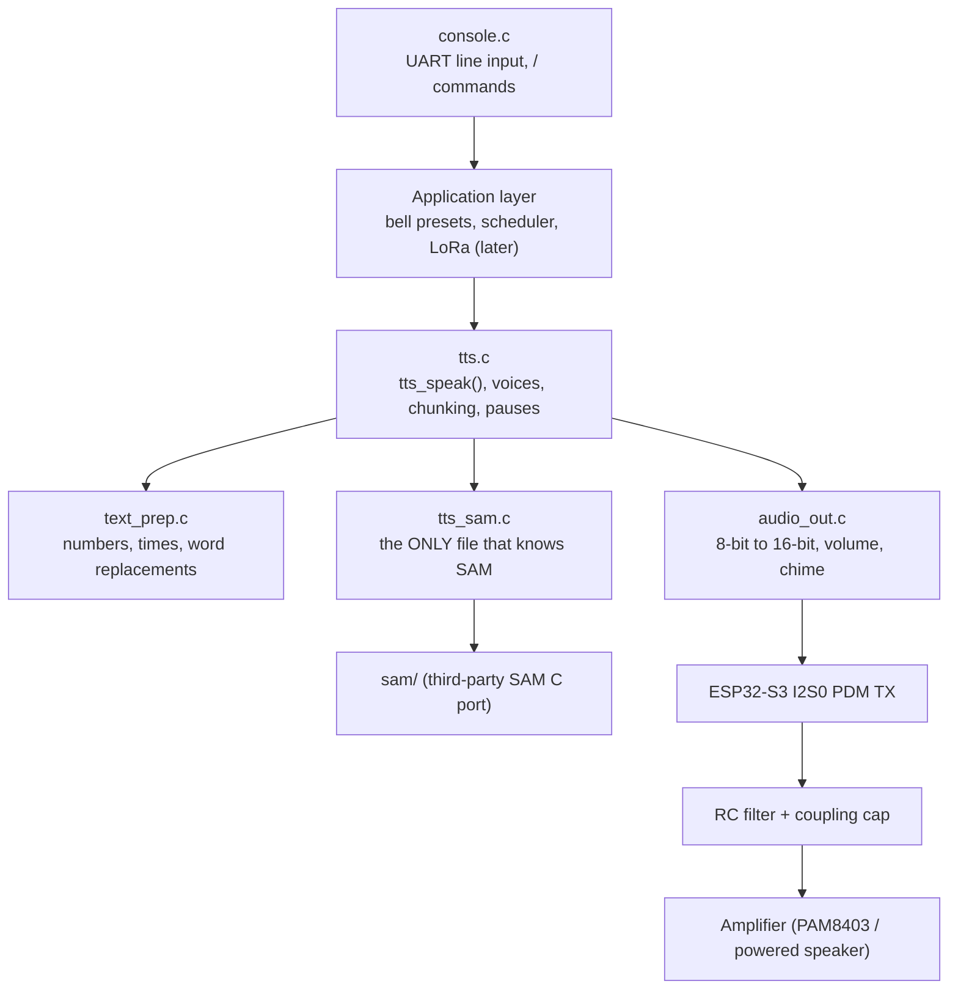

# Project: Offline Text-to-Speech on ESP32-S3 (SAM + I2S PDM)

## 1. Overview

A standalone, offline text-to-speech system for the **ESP32-S3**, built with **ESP-IDF v5.x**. It uses the **SAM** formant synthesizer for speech and the S3's **I2S PDM TX** peripheral for audio output on **GPIO 18**, so no DAC chip is required.

The school bell announcer is the first application, not the only one. The code is split so that the speech engine knows nothing about bells, and the bell logic knows nothing about SAM.

### Decisions made

| Decision | Reason |
|---|---|
| Use SAM now, custom engine later (optional) | Working speech today; much faster to learn by tuning something that already talks |
| Hide SAM behind a `tts_*` wrapper | SAM's licensing is unclear for public or commercial use; swapping engines must touch one file |
| PDM sample rate fixed at **22050 Hz** | Matches SAM's native output, so no resampling |
| Console commands start with `/` | Free text can contain any letter or digit without being mistaken for a command |
| Console on **UART**, not USB CDC | The original `USB_CDC` setting combined with reading `UART_NUM_0` meant typed input never arrived |
| Amplifier required | A GPIO pin cannot drive an 8 Ω speaker (see section 4) |

---

## 2. Architecture



### Directory layout

```
esp32s3_sam_tts/
├── CMakeLists.txt
├── sdkconfig.defaults
└── main/
    ├── CMakeLists.txt
    ├── main.c            # startup only
    ├── console.c         # serial console, commands, presets
    ├── audio_out.h/.c    # PDM output, volume, chime
    ├── tts.h/.c          # public speech API, voices, chunking
    ├── tts_backend.h     # backend interface
    ├── tts_sam.c         # SAM backend (swap this file to change engine)
    ├── text_prep.h/.c    # text normalisation
    └── sam/              # third-party SAM C port (sam.c, render.c, reciter.c, headers)
```

---

## 3. Memory

SAM's classic C port allocates a fixed output buffer of roughly 10 seconds at 22050 Hz, which is about **175-220 KB** depending on the port. That does not fit comfortably in internal RAM next to the rest of the system.

- Use a board with **PSRAM** (N8R8 or similar) and enable `CONFIG_SPIRAM_USE_MALLOC` so the large allocation lands there.
- Speech is split into chunks of at most **120 characters** at punctuation, rendered and played one chunk at a time.
- 8-bit to 16-bit conversion happens in 512-sample blocks on the stack, so no second large buffer is needed.
- Check the real numbers with the `/i` command rather than trusting estimates.

---

## 4. Hardware

```
ESP32-S3
┌──────────┐
│          │
│  GPIO 18 ├──[ 100 Ω ]──┬───────┤|──────────────► Amp input
│          │             │      10 µF (+ toward resistor)
│          │          [ 22 nF ]
│          │             │
│      GND ├─────────────┴──────────────────────► Amp GND
└──────────┘
```

- The **100 Ω + 22 nF** low-pass has a cutoff near 72 kHz. It is only first-order, so it gives roughly 29 dB of attenuation at the PDM bit clock (low MHz range). That is fine for an amp input, but do not rely on it as EMI protection.
- The **10 µF** capacitor blocks the DC offset (positive leg toward the resistor).
- **Do not drive a speaker from GPIO 18.** 3.3 V into 8 Ω would need about 400 mA; an ESP32 pin is good for a few tens of mA at most. The earlier "about 0.3 W into 8 Ω" claim was wrong.
- The signal swings the full 3.3 V. Add a 10 kΩ pot at the amp input if the amp is too loud or distorts.
- Verify the actual PDM bit clock on a scope if you care about it; do not assume the IDF default gives an exact 128x ratio.

---

## 5. Source Code

> Not compiled or tested yet. Written against ESP-IDF v5.x. Small API differences between 5.x minor versions (especially in the I2S PDM config macros) may need a tweak.

### Root `CMakeLists.txt`

```cmake
cmake_minimum_required(VERSION 3.16)
include($ENV{IDF_PATH}/tools/cmake/project.cmake)
project(esp32s3_sam_tts)
```

### `sdkconfig.defaults`

```ini
CONFIG_IDF_TARGET="esp32s3"
CONFIG_ESP_DEFAULT_CPU_FREQ_MHZ_240=y

# Console on the UART port (CP210x / CH340), NOT native USB
CONFIG_ESP_CONSOLE_UART_DEFAULT=y

# PSRAM. N8R8 boards use octal; N16R2 / N4R2 boards use quad.
CONFIG_SPIRAM=y
CONFIG_SPIRAM_MODE_OCT=y
# CONFIG_SPIRAM_MODE_QUAD=y
CONFIG_SPIRAM_USE_MALLOC=y
CONFIG_SPIRAM_MALLOC_ALWAYSINTERNAL=4096

CONFIG_ESP_MAIN_TASK_STACK_SIZE=8192
```

### `main/CMakeLists.txt`

```cmake
idf_component_register(
    SRCS
        "main.c" "console.c" "audio_out.c"
        "tts.c" "tts_sam.c" "text_prep.c"
        "sam/sam.c" "sam/render.c" "sam/reciter.c"
    INCLUDE_DIRS "." "sam"
    REQUIRES driver esp_timer
)
```

*(Adjust the `sam/` file list to match the SAM port you use.)*

### `main/audio_out.h`

```c
#pragma once
#include <stddef.h>
#include <stdint.h>
#include "esp_err.h"

esp_err_t audio_init(uint32_t sample_rate);
void audio_set_volume(int percent);          // 0..100
int  audio_get_volume(void);
void audio_play_u8(const uint8_t *s, size_t n);  // 8-bit unsigned (SAM output)
void audio_silence_ms(int ms);
void audio_chime(void);                      // C5 -> E5 -> G5
```

### `main/audio_out.c`

```c
#include <math.h>
#include <string.h>
#include "freertos/FreeRTOS.h"
#include "freertos/task.h"
#include "esp_log.h"
#include "driver/i2s_pdm.h"
#include "audio_out.h"

#define PDM_GPIO  GPIO_NUM_18
#define BLK       512

static const char *TAG = "audio";
static i2s_chan_handle_t s_tx;
static uint32_t s_rate;
static int s_vol = 70;                       // percent

esp_err_t audio_init(uint32_t sample_rate)
{
    s_rate = sample_rate;

    i2s_chan_config_t cc = I2S_CHANNEL_DEFAULT_CONFIG(I2S_NUM_0, I2S_ROLE_MASTER);
    cc.dma_desc_num  = 8;
    cc.dma_frame_num = 256;
    cc.auto_clear    = true;
    ESP_ERROR_CHECK(i2s_new_channel(&cc, &s_tx, NULL));

    i2s_pdm_tx_config_t pc = {
        .clk_cfg  = I2S_PDM_TX_CLK_DEFAULT_CONFIG(sample_rate),
        .slot_cfg = I2S_PDM_TX_SLOT_DEFAULT_CONFIG(I2S_DATA_BIT_WIDTH_16BIT,
                                                   I2S_SLOT_MODE_MONO),
        .gpio_cfg = {
            .clk  = I2S_GPIO_UNUSED,
            .dout = PDM_GPIO,
            .invert_flags = { .clk_inv = false },
        },
    };
    ESP_ERROR_CHECK(i2s_channel_init_pdm_tx_mode(s_tx, &pc));
    ESP_ERROR_CHECK(i2s_channel_enable(s_tx));
    ESP_LOGI(TAG, "PDM TX on GPIO %d at %u Hz", PDM_GPIO, (unsigned)sample_rate);
    return ESP_OK;
}

void audio_set_volume(int p) { s_vol = p < 0 ? 0 : (p > 100 ? 100 : p); }
int  audio_get_volume(void)  { return s_vol; }

static void write_block(const int16_t *p, size_t n)
{
    size_t w = 0;
    i2s_channel_write(s_tx, p, n * sizeof(int16_t), &w, portMAX_DELAY);
}

void audio_play_u8(const uint8_t *s, size_t n)
{
    int16_t blk[BLK];
    int32_t gain = (s_vol * 256) / 100;      // Q8 gain
    for (size_t i = 0; i < n; ) {
        size_t m = (n - i < BLK) ? (n - i) : BLK;
        for (size_t k = 0; k < m; k++) {
            int32_t v = ((int32_t)s[i + k] - 128) << 8;   // unsigned 8-bit -> signed 16-bit
            blk[k] = (int16_t)((v * gain) >> 8);
        }
        write_block(blk, m);
        i += m;
    }
}

void audio_silence_ms(int ms)
{
    int16_t blk[BLK] = {0};
    size_t n = (size_t)s_rate * ms / 1000;
    for (size_t i = 0; i < n; ) {
        size_t m = (n - i < BLK) ? (n - i) : BLK;
        write_block(blk, m);
        i += m;
    }
}

static void tone(float freq, int ms, float decay)
{
    int16_t blk[BLK];
    size_t n = (size_t)s_rate * ms / 1000;
    float g = s_vol / 100.0f;
    for (size_t i = 0; i < n; ) {
        size_t m = (n - i < BLK) ? (n - i) : BLK;
        for (size_t k = 0; k < m; k++) {
            float t = (float)(i + k) / s_rate;
            blk[k] = (int16_t)(sinf(2.0f * (float)M_PI * freq * t) * expf(-decay * t) * 12000.0f * g);
        }
        write_block(blk, m);
        i += m;
    }
}

void audio_chime(void)
{
    tone(523.25f, 300, 5.0f);   // C5
    tone(659.25f, 300, 5.0f);   // E5
    tone(783.99f, 500, 4.0f);   // G5
}
```

### `main/tts_backend.h`

```c
#pragma once
#include <stdbool.h>
#include <stddef.h>
#include <stdint.h>

/* Render `text` to 8-bit unsigned mono PCM at 22050 Hz.
 * On success returns true and sets *pcm / *n. The buffer stays valid
 * until tts_backend_release() is called. */
bool tts_backend_render(const char *text,
                        uint8_t speed, uint8_t pitch, uint8_t mouth, uint8_t throat,
                        const uint8_t **pcm, size_t *n);
void tts_backend_release(void);
```

### `main/tts_sam.c` (the only SAM-specific file)

```c
#include <ctype.h>
#include <string.h>
#include "tts_backend.h"
#include "sam.h"
#include "reciter.h"

/* Mirrors the main.c of the common C port of SAM:
 *   uppercase -> append '[' -> TextToPhonemes -> SetInput -> SAMMain.
 * Check these names and the buffer-length unit against YOUR port.
 * In the common port, sample count = GetBufferLength() / 50. */

bool tts_backend_render(const char *text,
                        uint8_t speed, uint8_t pitch, uint8_t mouth, uint8_t throat,
                        const uint8_t **pcm, size_t *n)
{
    char in[256];
    size_t len = strlen(text);
    if (len > 250) len = 250;
    for (size_t i = 0; i < len; i++) in[i] = (char)toupper((unsigned char)text[i]);
    in[len] = '\0';
    strcat(in, "[");

    if (!TextToPhonemes((unsigned char *)in)) return false;

    SetSpeed(speed);
    SetPitch(pitch);
    SetMouth(mouth);
    SetThroat(throat);
    SetInput(in);
    if (!SAMMain()) return false;

    *pcm = (const uint8_t *)GetBuffer();
    *n   = (size_t)(GetBufferLength() / 50);
    return *n > 0;
}

void tts_backend_release(void)
{
    /* If your SAM port mallocs its output buffer on every SAMMain() call,
     * free it here. Otherwise nothing to do. */
}
```

### `main/tts.h`

```c
#pragma once

#define TTS_SAMPLE_RATE 22050

void        tts_init(void);
void        tts_speak(const char *text);   // blocking
int         tts_next_voice(void);          // returns new voice index
const char *tts_voice_name(void);
```

### `main/tts.c`

```c
#include <stdbool.h>
#include <string.h>
#include "esp_log.h"
#include "tts.h"
#include "tts_backend.h"
#include "text_prep.h"
#include "audio_out.h"

#define MAX_CHUNK 120

typedef struct { const char *name; uint8_t speed, pitch, mouth, throat; } voice_t;

/* Starting points. Lower pitch number = higher voice. Tune by ear. */
static const voice_t VOICES[] = {
    { "Classic SAM",    72, 64, 128, 128 },
    { "Natural Male",   78, 58, 110, 105 },
    { "Natural Female", 82, 40, 145, 145 },
    { "Campus PA",      80, 60, 128, 128 },
    { "Robot",          92, 60, 190, 190 },
};
#define NVOICES (sizeof VOICES / sizeof VOICES[0])

static const char *TAG = "tts";
static int s_voice = 3;   // Campus PA by default

void tts_init(void) { }

int tts_next_voice(void)
{
    s_voice = (s_voice + 1) % NVOICES;
    return s_voice;
}

const char *tts_voice_name(void) { return VOICES[s_voice].name; }

static void speak_chunk(const char *s, size_t len)
{
    char buf[MAX_CHUNK + 2];
    memcpy(buf, s, len);
    buf[len] = '\0';

    const voice_t *v = &VOICES[s_voice];
    const uint8_t *pcm; size_t n;
    if (!tts_backend_render(buf, v->speed, v->pitch, v->mouth, v->throat, &pcm, &n)) {
        ESP_LOGW(TAG, "render failed for: %s", buf);
        return;
    }
    audio_play_u8(pcm, n);
    tts_backend_release();
}

void tts_speak(const char *text)
{
    static char norm[512];
    text_prep(text, norm, sizeof norm);
    ESP_LOGI(TAG, "speaking: %s", norm);

    const char *p = norm;
    while (*p) {
        while (*p == ' ') p++;
        if (!*p) break;

        size_t n = 0, last_space = 0;
        bool hit_punct = false;
        while (p[n] && n < MAX_CHUNK) {
            char c = p[n++];
            if (c == ' ') last_space = n;
            if (c == '.' || c == ',' || c == '?') { hit_punct = true; break; }
        }
        if (!hit_punct && p[n] && last_space) n = last_space;   // cut at a word boundary

        char last = p[n - 1];
        speak_chunk(p, n);
        p += n;

        if (last == '.' || last == '?') audio_silence_ms(300);
        else if (last == ',')           audio_silence_ms(150);
    }
}
```

### `main/text_prep.h`

```c
#pragma once
#include <stddef.h>
void text_prep(const char *in, char *out, size_t cap);
```

### `main/text_prep.c`

```c
#include <ctype.h>
#include <stdbool.h>
#include <stdlib.h>
#include <string.h>
#include <strings.h>
#include "text_prep.h"

/* Add words SAM mispronounces here (whole words, case-insensitive). */
static const struct { const char *from, *to; } REPLACE[] = {
    { "am",   "A M" },
    { "pm",   "P M" },
    { "wifi", "why fy" },
    { "esp",  "E S P" },
    /* { "school", "skool" }, */
};

static const char *ONES[] = {
    "zero","one","two","three","four","five","six","seven","eight","nine","ten",
    "eleven","twelve","thirteen","fourteen","fifteen","sixteen","seventeen",
    "eighteen","nineteen"
};
static const char *TENS[] = {
    "","","twenty","thirty","forty","fifty","sixty","seventy","eighty","ninety"
};

typedef struct { char *o; size_t cap, len; } sb_t;

static void sb_str(sb_t *b, const char *s)
{
    while (*s && b->len < b->cap - 1) b->o[b->len++] = *s++;
    b->o[b->len] = '\0';
}
static void sb_chr(sb_t *b, char c)
{
    if (b->len < b->cap - 1) { b->o[b->len++] = c; b->o[b->len] = '\0'; }
}

static void say_below100(sb_t *b, unsigned n)
{
    if (n < 20) { sb_str(b, ONES[n]); return; }
    sb_str(b, TENS[n / 10]);
    if (n % 10) { sb_chr(b, ' '); sb_str(b, ONES[n % 10]); }
}

static void say_number(sb_t *b, unsigned n)      // 0..9999
{
    bool any = false;
    if (n >= 1000) { say_below100(b, n / 1000); sb_str(b, " thousand"); n %= 1000; any = true; }
    if (n >= 100)  { if (any) sb_chr(b, ' '); sb_str(b, ONES[n / 100]); sb_str(b, " hundred"); n %= 100; any = true; }
    if (n > 0 || !any) { if (any) sb_chr(b, ' '); say_below100(b, n); }
}

void text_prep(const char *in, char *out, size_t cap)
{
    sb_t b = { out, cap, 0 };
    out[0] = '\0';

    for (const char *p = in; *p; ) {
        if (isdigit((unsigned char)*p)) {
            char dg[16]; size_t n = 0;
            const char *q = p;
            while (isdigit((unsigned char)*q)) { if (n < 15) dg[n++] = *q; q++; }
            dg[n] = '\0';

            if (n <= 2 && *q == ':' && isdigit((unsigned char)q[1]) && isdigit((unsigned char)q[2])) {
                unsigned m = (q[1] - '0') * 10 + (q[2] - '0');
                say_number(&b, (unsigned)atoi(dg));
                if (m == 0) sb_str(&b, " o clock");
                else { sb_chr(&b, ' '); if (m < 10) sb_str(&b, "oh "); say_below100(&b, m); }
                q += 3;
            } else if (n <= 4 && (n == 1 || dg[0] != '0')) {
                say_number(&b, (unsigned)atoi(dg));
            } else {
                for (size_t i = 0; i < n; i++) { if (i) sb_chr(&b, ' '); sb_str(&b, ONES[dg[i] - '0']); }
            }
            if (isalnum((unsigned char)*q)) sb_chr(&b, ' ');
            p = q;
        } else if (isalpha((unsigned char)*p)) {
            char w[32]; size_t n = 0;
            while (isalpha((unsigned char)*p)) { if (n < 31) w[n++] = *p; p++; }
            w[n] = '\0';

            const char *rep = w;
            for (size_t i = 0; i < sizeof REPLACE / sizeof REPLACE[0]; i++)
                if (strcasecmp(w, REPLACE[i].from) == 0) { rep = REPLACE[i].to; break; }
            sb_str(&b, rep);
        } else {
            char c = *p++;
            if (c == ';' || c == ':') c = ',';
            if (c == '!') c = '.';
            sb_chr(&b, c);
        }
    }
}
```

### `main/console.c`

```c
#include <stdio.h>
#include <string.h>
#include "freertos/FreeRTOS.h"
#include "freertos/task.h"
#include "driver/uart.h"
#include "esp_heap_caps.h"
#include "esp_system.h"
#include "tts.h"
#include "audio_out.h"

#define CON_UART UART_NUM_0

static const char *PRESETS[] = {
    "Warning bell. Morning assembly starts in five minutes.",
    "Period one has commenced. Faculty please proceed to classrooms.",
    "Lunch interval has begun.",
    "Attention all personnel. Fire evacuation drill in progress.",
    "Campus bell text to speech system online.",
};

static void print_menu(void)
{
    printf("\r\nType text + Enter to speak. Commands start with '/':\r\n"
           "  /1../5 presets   /v voice   /c chime   /+ /- volume   /i memory   /? menu\r\n");
}

static void run_command(char c)
{
    if (c >= '1' && c <= '5') { audio_chime(); tts_speak(PRESETS[c - '1']); return; }
    switch (c) {
    case 'v': tts_next_voice(); printf("Voice: %s\r\n", tts_voice_name()); tts_speak("Voice changed."); break;
    case 'c': audio_chime(); break;
    case '+': audio_set_volume(audio_get_volume() + 10); printf("Volume %d%%\r\n", audio_get_volume()); break;
    case '-': audio_set_volume(audio_get_volume() - 10); printf("Volume %d%%\r\n", audio_get_volume()); break;
    case 'i':
        printf("Internal free: %u, PSRAM free: %u, PSRAM largest block: %u\r\n",
               (unsigned)esp_get_free_internal_heap_size(),
               (unsigned)heap_caps_get_free_size(MALLOC_CAP_SPIRAM),
               (unsigned)heap_caps_get_largest_free_block(MALLOC_CAP_SPIRAM));
        break;
    default: print_menu();
    }
}

static void handle_line(const char *line)
{
    if (line[0] == '/') run_command(line[1]);
    else                tts_speak(line);
}

static void console_task(void *arg)
{
    char line[256];
    size_t n = 0;
    uint8_t ch;

    print_menu();
    for (;;) {
        if (uart_read_bytes(CON_UART, &ch, 1, portMAX_DELAY) <= 0) continue;

        if (ch == '\r' || ch == '\n') {
            uart_write_bytes(CON_UART, "\r\n", 2);
            if (n) { line[n] = '\0'; n = 0; handle_line(line); }   // empty lines (CRLF pairs) ignored
        } else if (ch == 0x08 || ch == 0x7f) {
            if (n) { n--; uart_write_bytes(CON_UART, "\b \b", 3); }
        } else if (ch >= 32 && ch < 127 && n < sizeof line - 1) {
            line[n++] = (char)ch;
            uart_write_bytes(CON_UART, (const char *)&ch, 1);      // local echo
        }
    }
}

void console_start(void)
{
    uart_driver_install(CON_UART, 1024, 0, 0, NULL, 0);
    xTaskCreate(console_task, "console", 8192, NULL, 5, NULL);
}
```

### `main/main.c`

```c
#include "esp_log.h"
#include "audio_out.h"
#include "tts.h"

void console_start(void);

void app_main(void)
{
    ESP_ERROR_CHECK(audio_init(TTS_SAMPLE_RATE));
    tts_init();
    console_start();

    audio_chime();
    tts_speak("Text to speech system online.");
}
```

---

## 6. Roadmap

| Phase | Goal | Done when |
|---|---|---|
| 0 | Speaker test project (`README_SPEAKER_TEST.md`) | Chime, sweep and vowel test sound clean through the amp |
| 1 | Console input works | Typing a line in the monitor echoes back and is received; `/?` shows the menu |
| 2 | SAM integrated | `Hello world` is spoken; `/i` shows PSRAM in use and no leak after 50 sentences |
| 3 | Text preparation | `Warning bell at 10:30 AM` is spoken as "ten thirty A M"; mispronounced words fixed via the replacement table |
| 4 | Voices and polish | Five voices tuned by ear and saved; optional post filter (low-pass near 3.4 kHz, high-pass near 100 Hz) tried and compared A/B |
| 5 | Bell application | Scheduler (RTC module or NTP if Wi-Fi is available) triggers presets at set times |
| 6 | Optional | Replace the backend (own engine, eSpeak-NG port, or recorded phrases) without touching other files |

---

## 7. Known Limitations

- SAM is robotic by nature, and it will mispronounce some words.
- English only.
- Speech is rendered chunk by chunk, so there is a short delay before each chunk starts.
- SAM licensing is unclear for public or commercial products.
- No hardware volume control unless you add the potentiometer.
